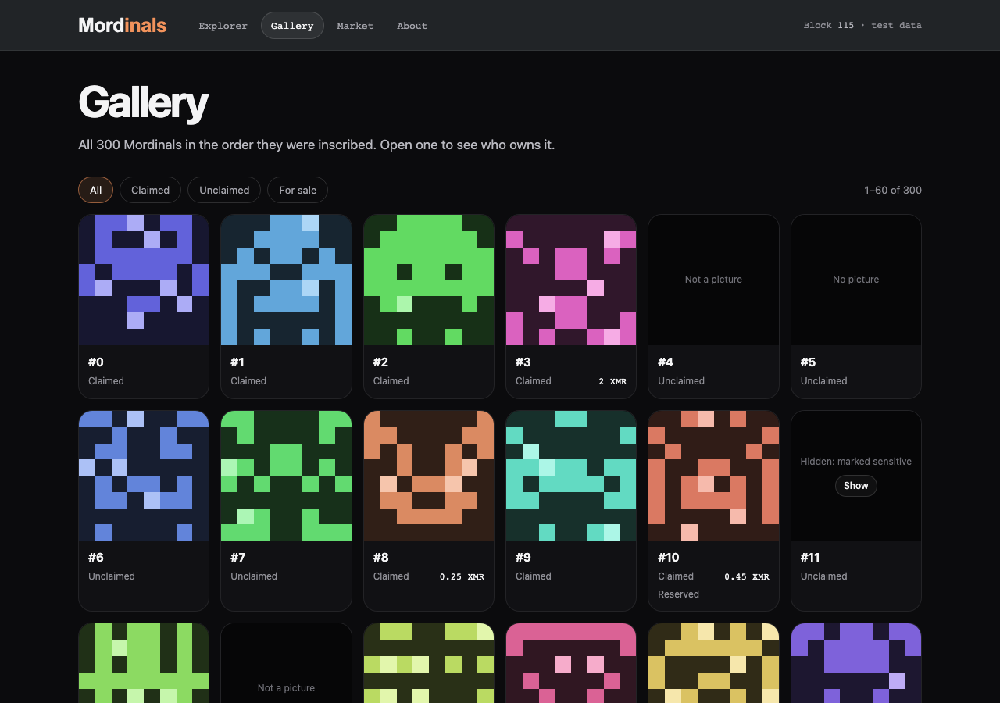

# XMR721

**XMR721** is an NFT standard for Monero. An NFT is owned by an ordinary Monero address and
is sent and sold with a wallet signature. No coin is spent to move it, so nothing about
anyone's Monero spending is made public.

Its first collection is **Mordinals**, the 2023 inscriptions on Monero. This repository holds
the full ownership index of all of them, the rules, and the reader and relay that run the
standard. With it a Mordinal can be claimed, sent and sold without spending the coin it was
inscribed on.

The name follows the XMR20 token standard, the same way NFT standards on other chains
follow their token standards.

> **Draft.** Nothing here is live. No start block is set, the rules have not had an outside
> review, and the relay runs on test chains only. See [Status](#status).



## What Mordinals were

In March 2023 a modified Monero node and wallet ([mooonero/mordinals](https://github.com/mooonero/mordinals))
let people inscribe pictures and other files into Monero transactions. An inscription sat in
the transaction's extra data, and whoever held the first output of that transaction owned
the Mordinal. 42,894 were made.

Two things went wrong.

**Moving one broke Monero's privacy.** To transfer a Mordinal the owner had to spend the
inscribed coin in a ring whose other members were 16 fixed, unspendable keys. That showed
everyone exactly which coin was spent. A coin known to be spent hides nothing when another
wallet later picks it as a decoy (a "black marble"), so every transfer made other people's
transactions a little easier to trace. The Monero community objected, and nodes soon stopped
relaying transactions with large extra data.

**Then the tooling disappeared.** The explorers and marketplaces that showed and traded
Mordinals shut down or were abandoned. The original software was not kept up with the
network. Nobody published an index of which Mordinals exist and who holds them.

What the chain says today (read to block 3,802,870, 9 November 2026):

| | |
|---|---|
| Mordinals | 42,894 |
| Transfers ever made under the original rules | 164, moving 139 Mordinals |
| Of those, in April 2023 | 120 |
| Last transfer | 22 December 2023 |
| Mordinals still on the coin they were inscribed on | 42,755 |

The Mordinals are all still there. For almost three years nothing could be done with them.

## What XMR721 does

**1. A full ownership index.** [`ownership-index/`](ownership-index) holds the owner of every
Mordinal under the original rules, worked out from the chain by running the original index
code unchanged and a second, separately written replay next to it. The two agree on all
42,894 Mordinals and every transfer. As far as we know this is the only complete, public
index of Mordinals and their owners.

**2. Rules for owning them without spending them.** [`RULES.md`](RULES.md), the XMR721
rules:

- At a start block the owner list is fixed. Every Mordinal keeps its number and its history.
- The holder **claims** a Mordinal once, to an ordinary Monero address, with a signature made
  by the key of the inscribed coin. The coin is not spent and stays an ordinary coin.
- After that it **moves** by a message signed in a Monero wallet ("sign message" in Feather,
  Cake Wallet, the Monero command-line wallet or the XMR20 wallet). No ring is touched.
- It can be **sold** for XMR. The seller signs a listing, the buyer reserves it and pays with
  a normal Monero transaction, and a proof of that payment completes the sale. Of each sale
  95% goes to the seller and 5% to a protocol fee address.
- Every record is a short byte string carried in an ordinary Monero transaction, so the
  ledger can be rebuilt by anyone from the chain and the owner list alone.

**3. The software to run it.** [`rules/`](rules) is the rule library, [`reader/`](reader)
follows the chain and keeps the ledger, serves it to wallets and pages, and includes a relay
that carries signed records for wallets that cannot build such a transaction themselves.
The relay cannot change a record. A check tool replays a reader's log without trusting it.

## The largest inscription on Monero

On 5 November 2026 the XMR20 project mined block 3,799,494 with a 598,000-byte video
inscribed in its mining reward transaction. It is the largest block in Monero's history
(weight 599,000; the previous record was 569,375 at block 2,274,242 in January 2021) and
holds the largest transaction and extra data we know of. The largest inscription made under
the original Mordinals rules is 141,345 bytes (#264).

The original rules only read ordinary transactions, so by those rules the video is not a
Mordinal. XMR721 adds it as one extra entry, number 42,894, after the original 42,894
(numbers 0 to 42,893). The entry and the tool that builds and checks it from any Monero node
are in [`ownership-index/added/`](ownership-index/added). The reader's pages do not play
video yet.

## XMR20 NFTs: the GENESIS collection

In October 2026 the XMR20 project inscribed GENESIS on Monero: 100 small renderings of
well-known paintings, each one complete in a single transaction. They were made before
XMR721, in an earlier format of their own, and are owned by Monero addresses from the
start, so no coin is ever exposed.
[`xmr20-nfts/`](xmr20-nfts) holds the collection as rebuilt from the chain, the
[format](xmr20-nfts/FORMAT.md) and the code that decodes and checks it. That format is
legacy; new inscriptions are planned to use XMR721.

## Layout

| Path | What |
|---|---|
| [`RULES.md`](RULES.md) | The XMR721 rules (draft 4): records, checks, fee rule, privacy rules, new NFTs |
| [`rules/`](rules) | The rule library, its offline tests, and tests against real wallet software on a local test chain |
| [`reader/`](reader) | Reader, relay, HTTP service, explorer/gallery/market pages, check tools |
| [`ownership-index/`](ownership-index) | The owner list, how it was made and checked, and the added entry |
| [`xmr20-nfts/`](xmr20-nfts) | The GENESIS collection of XMR20 NFTs, their earlier format and decoder |
| [`xmr20-tokens/`](xmr20-tokens) | XMR20 tokens as inscriptions on this ledger: the [deploy text](xmr20-tokens/FORMAT.md), the token list a reader serves, and the launch inscriber; and the [earlier XMR20 deploy inscriptions](xmr20-tokens/EARLIER.md) from before this ledger, as a checked list every reader serves |
| [`docs/OPEN-POINTS.md`](docs/OPEN-POINTS.md) | What review has changed so far and what is still open |

## Try it

Node.js 22 or newer.

```
npm install
npm test          # rule library, reader and NFT decoder, offline, a few seconds
npm run demo      # explorer, gallery and market at http://127.0.0.1:18951/view/ with made-up data
```

The demonstration uses a made-up chain, owner list and wallets; nothing in it is real.
`npm run test:views` drives the pages in a browser (run `npx playwright install chromium`
once). `npm run test:lab` runs the rules and the relay against `monerod` and
`monero-wallet-rpc` on an offline test chain: set `MONERO_BIN` to the folder that holds
them and build the relay's wallet first with `sh reader/carrier/build.sh`.

## Status

- **Draft, not live.** No start block, ledger domain or fee address has been chosen.
- **Not independently reviewed.** The claim signature and the payment proof are new code.
  [`docs/OPEN-POINTS.md`](docs/OPEN-POINTS.md) lists what a reviewer should read first and
  what is known to be open.
- **Test chains only.** The relay's wallet refuses a mainnet node. No record has been put
  on mainnet.
- **Wallets are not in this repository.** Claim, send and sell screens exist for the XMR20
  wallets as test builds and will be published with those wallets.
- **New NFTs.** Draft 4 adds collections, mints of up to about 800 bytes in one
  transaction, and burning (RULES.md section 9). The pages can create, show, send, sell and
  burn them by signed message. A site that hosts the pages can give them a wallet
  that approves such a record itself (`signRecord` in `reader/views/wallet.js`); the
  released wallets do not have this yet.
- **Anyone can run a competing index.** Ownership here rests on people agreeing to these
  rules. That is why the index, the rules and the reader are public and reproducible.

## Credit

Mordinals were created in 2023 by the authors of
[mooonero/mordinals](https://github.com/mooonero/mordinals). The inscriptions are theirs and
their holders'; XMR721 does not change them, and the name Mordinals stays with them. The ownership index runs the original
index code from that repository, unmodified, at commit `8467001`.

Maintained by the [XMR20](https://xmr20.org/) project. MIT licence.
